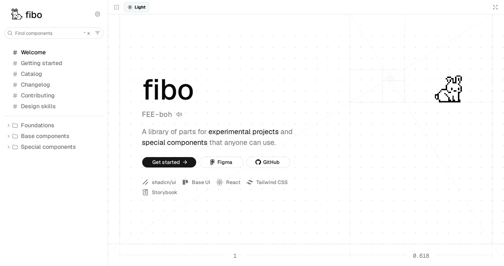

# fibo

A shadcn registry for experimental projects and special components.

fibo is an achromatic design system built on [shadcn/ui](https://ui.shadcn.com)
and [Base UI](https://base-ui.com), with a Figma library that's checked against
the code on every pull request. Parts install from the registry as source, so
they follow your tokens and belong to you once they land.

[](https://github.com/toribryan/fibo/actions/workflows/ci.yml)
[](./LICENSE)
[](https://fibo.toribryan.com)

[Docs](https://fibo.toribryan.com) ·
[Catalog](https://fibo.toribryan.com/?path=/docs/catalog--docs) ·
[Figma library](https://www.figma.com/design/LJZ5Tt4Ba7NPPi8Xnq8i0e/Fibo-DS) ·
[llms.txt](https://fibo.toribryan.com/llms.txt) ·
[Changelog](./CHANGELOG.md)



## Install

Add the registry to your project's `components.json` once:

```json
{
  "registries": {
    "@fibo": "https://fibo.toribryan.com/r/{name}.json"
  }
}
```

Then add any part by name. Anything it depends on comes with it:

```bash
pnpm dlx shadcn@latest add @fibo/button
```

Each part brings the tokens it uses that a stock shadcn theme lacks, such as
`--primary-hover` and `--ring-subtle`, and leaves your existing tokens alone. To
make everything look the way it does in the docs, add the full theme too:

```bash
pnpm dlx shadcn@latest add @fibo/theme
```

## How fibo is built

What keeps the registry, the docs and the Figma library honest with each other.

- **Every part is installed the way you'd install it.** On every pull request,
  CI runs `shadcn init` in a fresh Next.js app, installs all of fibo into it,
  builds it, and fails if any class in an installed file compiles to nothing.
  Tailwind drops utilities for unknown tokens without an error, so this is the
  only way to catch a part that ships without its tokens.
  [`smoke-install.mjs`](./apps/registry/scripts/smoke-install.mjs)
- **Figma and code are diffed in CI.** Color variables against `globals.css`,
  radii against the radius scale, and each Figma component's variant
  properties against its cva variants and props. Intended differences are
  listed with a reason. [`figma/drift.mjs`](./figma/drift.mjs)
- **Tokens a designer can bind.** Figma can't put opacity on a
  variable-bound fill, so `bg-destructive/10` has no Figma equivalent. fibo
  names those steps instead (`-subtle`, `-hover`, `-ring`), and the two sides
  use one name. Status tones sit on the 700 step so every pair clears WCAG AA
  in both themes. [Colors](https://fibo.toribryan.com/?path=/docs/foundations-colors--docs)
- **Accessibility is a test, not a review.** Every story renders in Chromium
  and fails on any axe violation. Every interactive part has a `play` function
  that drives it by pointer and keyboard.
- **Breaking changes ship with codemods.** A deprecation is one entry in
  [`components.meta.json`](./packages/ui/components.meta.json) that the docs
  banner, sidebar, registry output and `llms.txt` all read, plus a tested
  jscodeshift transform served from the site.
  [`codemods/`](./apps/registry/codemods)
- **Decisions are written down.** Anything that needs a choice before the
  code gets a numbered plan covering the options and what was chosen, kept
  after it ships. [`plans/`](./plans)
- **Built for agents too.** `llms.txt` lists every part and says the list is
  complete, the [shadcn MCP server](https://ui.shadcn.com/docs/mcp) can browse
  and install `@fibo` parts, and the repo ships an `add-component` skill and a
  `component-reviewer` subagent that build and review parts to spec.
  [`AGENTS.md`](./AGENTS.md)

## What's inside

Every part has a docs page with a playground, usage guidelines, do's and
don'ts, its anatomy, a props and data attributes reference, and accessibility
notes.

<!-- parts:start: written by pnpm registry:build -->

**35 base components.** The standard set. They depend on nothing beyond Base UI, `class-variance-authority` and `lucide-react`, except Data table (TanStack Table) and Rich text editor (Tiptap).

| Group      | Parts                                                                                                                                                                                                                                                                                                                            |
| ---------- | -------------------------------------------------------------------------------------------------------------------------------------------------------------------------------------------------------------------------------------------------------------------------------------------------------------------------------- |
| Actions    | [Button][button], [Jump bar][jump-bar]                                                                                                                                                                                                                                                                                           |
| Forms      | [Calendar][calendar], [Chat composer][chat-composer], [Checkbox][checkbox], [Date picker][date-picker], [Field][field], [Input][input], [Input group][input-group], [Label][label], [Radio group][radio-group], [Rich text editor][rich-text-editor], [Select][select], [Slider][slider], [Switch][switch], [Textarea][textarea] |
| Display    | [Avatar][avatar], [Badge][badge], [Count][count], [Data table][data-table], [Kbd][kbd], [Message list][message-list], [Separator][separator], [Status dot][status-dot], [Table][table]                                                                                                                                           |
| Navigation | [Pagination][pagination], [Tabs][tabs]                                                                                                                                                                                                                                                                                           |
| Overlays   | [Menu][menu], [Sheet][sheet], [Tooltip][tooltip]                                                                                                                                                                                                                                                                                 |
| Feedback   | [Empty state][empty-state], [Progress][progress], [Skeleton][skeleton], [Toast][toast], [Typing indicator][typing-indicator]                                                                                                                                                                                                     |

**12 special components.** Playful parts built for one kind of moment. They may bring `motion` with them.

| Group      | Parts                                                                                                                        |
| ---------- | ---------------------------------------------------------------------------------------------------------------------------- |
| Forms      | [Voice memo][voice-memo]                                                                                                     |
| Display    | [Annotated text][annotated-text], [Map pin][map-pin], [Sticker avatar][sticker-avatar]                                       |
| Navigation | [Chapter scrubber][chapter-scrubber], [Command menu][command-menu], [Filter menu][filter-menu], [Floating nav][floating-nav] |
| Feedback   | [Pixel snail][pixel-snail], [Reactions][reactions]                                                                           |
| Diagrams   | [Integration visual][integration-visual], [Token flow][token-flow]                                                           |

**2 blocks.** Whole screens composed from the parts above. A block installs once into `components/blocks/<name>/` and is then yours to edit.

| Group  | Parts                  |
| ------ | ---------------------- |
| Pages  | [Sitemap][sitemap]     |
| Shells | [App shell][app-shell] |

**3 themes.** [Theme][theme] (`@fibo/theme`), [Mechanical theme][theme-mechanical] (`@fibo/theme-mechanical`), [Electrical theme][theme-electrical] (`@fibo/theme-electrical`).

[avatar]: https://fibo.toribryan.com/?path=/docs/base-components-display-avatar--docs
[badge]: https://fibo.toribryan.com/?path=/docs/base-components-display-badge--docs
[button]: https://fibo.toribryan.com/?path=/docs/base-components-actions-button--docs
[calendar]: https://fibo.toribryan.com/?path=/docs/base-components-forms-calendar--docs
[chat-composer]: https://fibo.toribryan.com/?path=/docs/base-components-forms-chat-composer--docs
[checkbox]: https://fibo.toribryan.com/?path=/docs/base-components-forms-checkbox--docs
[count]: https://fibo.toribryan.com/?path=/docs/base-components-display-count--docs
[data-table]: https://fibo.toribryan.com/?path=/docs/base-components-display-data-table--docs
[date-picker]: https://fibo.toribryan.com/?path=/docs/base-components-forms-date-picker--docs
[empty-state]: https://fibo.toribryan.com/?path=/docs/base-components-feedback-empty-state--docs
[field]: https://fibo.toribryan.com/?path=/docs/base-components-forms-field--docs
[input]: https://fibo.toribryan.com/?path=/docs/base-components-forms-input--docs
[input-group]: https://fibo.toribryan.com/?path=/docs/base-components-forms-input-group--docs
[jump-bar]: https://fibo.toribryan.com/?path=/docs/base-components-actions-jump-bar--docs
[kbd]: https://fibo.toribryan.com/?path=/docs/base-components-display-kbd--docs
[label]: https://fibo.toribryan.com/?path=/docs/base-components-forms-label--docs
[menu]: https://fibo.toribryan.com/?path=/docs/base-components-overlays-menu--docs
[message-list]: https://fibo.toribryan.com/?path=/docs/base-components-display-message-list--docs
[pagination]: https://fibo.toribryan.com/?path=/docs/base-components-navigation-pagination--docs
[progress]: https://fibo.toribryan.com/?path=/docs/base-components-feedback-progress--docs
[radio-group]: https://fibo.toribryan.com/?path=/docs/base-components-forms-radio-group--docs
[rich-text-editor]: https://fibo.toribryan.com/?path=/docs/base-components-forms-rich-text-editor--docs
[select]: https://fibo.toribryan.com/?path=/docs/base-components-forms-select--docs
[separator]: https://fibo.toribryan.com/?path=/docs/base-components-display-separator--docs
[sheet]: https://fibo.toribryan.com/?path=/docs/base-components-overlays-sheet--docs
[skeleton]: https://fibo.toribryan.com/?path=/docs/base-components-feedback-skeleton--docs
[slider]: https://fibo.toribryan.com/?path=/docs/base-components-forms-slider--docs
[status-dot]: https://fibo.toribryan.com/?path=/docs/base-components-display-status-dot--docs
[switch]: https://fibo.toribryan.com/?path=/docs/base-components-forms-switch--docs
[table]: https://fibo.toribryan.com/?path=/docs/base-components-display-table--docs
[tabs]: https://fibo.toribryan.com/?path=/docs/base-components-navigation-tabs--docs
[textarea]: https://fibo.toribryan.com/?path=/docs/base-components-forms-textarea--docs
[toast]: https://fibo.toribryan.com/?path=/docs/base-components-feedback-toast--docs
[tooltip]: https://fibo.toribryan.com/?path=/docs/base-components-overlays-tooltip--docs
[typing-indicator]: https://fibo.toribryan.com/?path=/docs/base-components-feedback-typing-indicator--docs
[annotated-text]: https://fibo.toribryan.com/?path=/docs/special-components-annotated-text--docs
[chapter-scrubber]: https://fibo.toribryan.com/?path=/docs/special-components-chapter-scrubber--docs
[command-menu]: https://fibo.toribryan.com/?path=/docs/special-components-command-menu--docs
[filter-menu]: https://fibo.toribryan.com/?path=/docs/special-components-filter-menu--docs
[floating-nav]: https://fibo.toribryan.com/?path=/docs/special-components-floating-nav--docs
[integration-visual]: https://fibo.toribryan.com/?path=/docs/special-components-integration-visual--docs
[map-pin]: https://fibo.toribryan.com/?path=/docs/special-components-map-pin--docs
[pixel-snail]: https://fibo.toribryan.com/?path=/docs/special-components-pixel-snail--docs
[reactions]: https://fibo.toribryan.com/?path=/docs/special-components-reactions--docs
[sticker-avatar]: https://fibo.toribryan.com/?path=/docs/special-components-sticker-avatar--docs
[token-flow]: https://fibo.toribryan.com/?path=/docs/special-components-token-flow--docs
[voice-memo]: https://fibo.toribryan.com/?path=/docs/special-components-voice-memo--docs
[app-shell]: https://fibo.toribryan.com/?path=/docs/blocks-app-shell--docs
[sitemap]: https://fibo.toribryan.com/?path=/docs/blocks-sitemap--docs
[theme]: https://fibo.toribryan.com/?path=/docs/foundations-colors--docs
[theme-mechanical]: https://fibo.toribryan.com/?path=/docs/foundations-themes--docs
[theme-electrical]: https://fibo.toribryan.com/?path=/docs/foundations-themes--docs

<!-- parts:end -->

## Principles

- **Achromatic by default.** There is no brand hue. `primary` is a neutral and
  color only ever carries meaning: destructive, success, warning, info.
- **One name on both sides.** Every token in `globals.css` matches a Figma
  variable, and every prop matches a Figma component property.
- **Tailwind's scales, fibo's opinions.** Spacing, type, shadows and durations
  are Tailwind's own. fibo adds no tokens for them; its foundations pages say
  which steps it uses and what each is for.
- **Yours once installed.** Installing a part copies its source into your
  project, where you can change it like any other file.

## Development

Requires Node 24 (pinned in `.nvmrc`) and pnpm.

```bash
pnpm install
pnpm storybook
```

Storybook runs at http://localhost:6006.

| Script                         | What it does                                                          |
| ------------------------------ | --------------------------------------------------------------------- |
| `pnpm storybook`               | Storybook                                                             |
| `pnpm dev`                     | Every app in dev mode                                                 |
| `pnpm build`                   | Build the registry and Storybook                                      |
| `pnpm build:site`              | Build, then assemble the deployable site in `dist/`                   |
| `pnpm registry:build`          | Regenerate the registry JSON, `llms.txt` and this README's parts list |
| `pnpm --filter registry smoke` | Install every part into a fresh shadcn app                            |
| `pnpm figma:drift`             | Compare the Figma snapshot with the code                              |
| `pnpm lint`                    | ESLint, zero warnings allowed                                         |
| `pnpm typecheck`               | TypeScript in every workspace                                         |
| `pnpm test`                    | Unit, interaction and accessibility tests in Chromium                 |
| `pnpm format:write`            | Prettier                                                              |

CI runs format, lint, Figma drift, build, typecheck and tests on every pull
request, plus the install smoke test. The repo layout and the registry build
are described in [`AGENTS.md`](./AGENTS.md).

## Contributing

Issues and pull requests are welcome. Start with
[CONTRIBUTING.md](./CONTRIBUTING.md).

## License

[MIT](./LICENSE) © Tori Bryan
